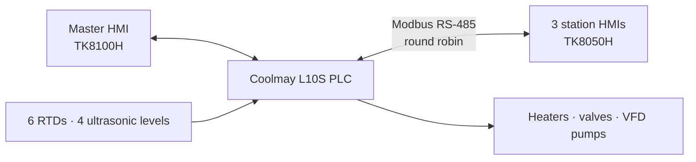

# Nebico Palm Oil Melting & Retention System

**Solar + electric heating, a PLC-driven control architecture, and three metered dispensing stations. Designed, programmed and commissioned in the field.**

*Sambridda Ranabhat · Automation and Process Design Engineer (Internship) · [Mechatronics Engineering Pvt. Ltd.](https://github.com) (MEPL), Kathmandu*

  

---

## At a glance

| | |
|---|---|
| **1 %** | dispensing error, against a 3 % target |
| **3,300 → 1,800** | ladder steps, from the 3.x series to the deployed 5.4 |
| **27 kW + solar** | three 9 kW heaters plus a 10-panel, 19.0 m² solar array |
| **6 tanks · 3 stations** | all stations functional and dispensing |
| **~8 t/day** | modelled output from a warm start (target 2, satisfactory 4) |

## The problem

Nebico melted palm oil by hand: packets kept in a hot room, squeezed manually to be measured. The job was to replace that with a system that keeps the oil liquid and dispenses a measured mass on demand.

## The system

- **Plant:** three 10 kL reservoir tanks (TA, TB, TC), a 5 kL holding tank (T5), a heating tank and a solar tank on a shared hydronic loop, 400 L of water
- **Heat:** 27 kW of electric heating plus the solar loop, with the solar cycle chosen by comparing solar and heating-tank temperatures
- **Dispensing:** three stations, first come first served, timed from a calibrated flow rate with a temperature correction for viscosity; a failed Modbus poll simply moves on and retries in the loop

## What I did

- **Thermal sizing and modelling.** A closed-form ε-NTU coil-length inversion replaced trial-and-error coil sizing. A 1D radial, 100-shell enthalpy model of the tank replaced an earlier 2-zone model.
- **Control architecture (ADA).** Five revisions to ADA 2.0.1, a deliberate simplification to ADA 3.0, then a ground-up rebuild into the deployed program 5.4: no priority scheduler, a demand is registered and acted on as it arises.
- **PLC and HMI.** Ladder logic on the Coolmay L10S, a supervisory HMI, three station HMIs, and Modbus round-robin polling.
- **Electrical and panel.** Full schematic, main control panel and three substation layouts, and field wiring sized on site.
- **Commissioning and calibration.** Sensor, level and dispense calibration against Nebico's own weighing machine.

## Findings that changed the design

- **The oil side is the bottleneck.** Oil-side thermal resistance is over 95 % of the total, so pump velocity and coil bore barely matter. The design moved from bigger pipes to smarter dispatch.
- **How you run it beats the weather.** In the coldest case a cold-started tank gives no usable liquid in 24 h, while a warm carry-over gives about 8 t/day. There is no reheat routine: on restart the operator sets a high target temperature.
- **Solar coverage, honestly stated.** Calculation gives 6.4–9.5 %, a downward correction of the 40–61 % reported in earlier revisions. In the field, palm oil needs less energy than modelled, so real coverage sits above that range and below 50 %.

| Modelled 24 h output, two tanks | Cold start | Warm start |
|---|---|---|
| 7 °C ambient | 0 kg | ~7,950 kg |
| 18 °C ambient | 4,749 kg | ~8,495 kg |
| 22 °C ambient | 6,649 kg | ~8,680 kg |

## Judgement calls

- **Simplicity over completeness.** Subtractions were the best decisions: one scoring formula instead of two, one tunable fault check instead of twelve registers per channel, then no priorities at all in 5.4.
- **Scrapped my own data.** The first RTD calibration was taken before the readings had settled, so I discarded it and re-measured all six sensors from a blank sheet.
- **Got the panel wrong.** The first enclosure I sized was too small and was already fabricated when I caught it. I now over-check enclosure sizing before fabrication.
- **Went to the manufacturer.** When Modbus across several Coolmay HMIs failed silently, I contacted Coolmay's own engineer for the register configuration.

## Status

**Deployed.** All three stations are functional and dispensing. A replacement flow meter is on the way, and the program is ready for it. Field failures and lessons learned are written up separately.

## Documentation

| Document | Role |
|---|---|
| Nebico Palm Oil Retention/Melting: Project Document | Final report: the system as deployed, how it was tested, and my role |
| ADA: Palm Oil Retention Architecture, v5.4 | Architecture and operation of the deployed program |
| VCH Sizing Framework, 2nd Ed. | Published sizing methodology ([DOI](https://doi.org/10.5281/zenodo.21009246)) |

**History (superseded by 5.4):** ADA Architecture 3.0, ADA PLC Guide V3.0, PLC Overview (Program 3.3), Commissioning Verification Checklist Rev. 3, Site Testing & Calibration v1.0, ADA Thermodynamic Analysis, ADA 1D Radial Thermal Model.

The full engineering history is in **[ARCHIVE.md](./ARCHIVE.md)**.
